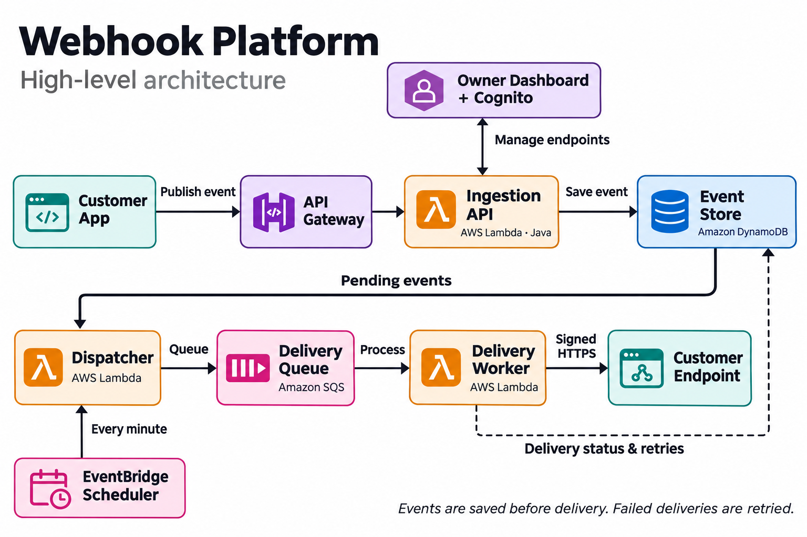
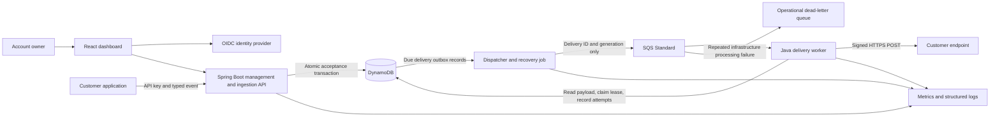
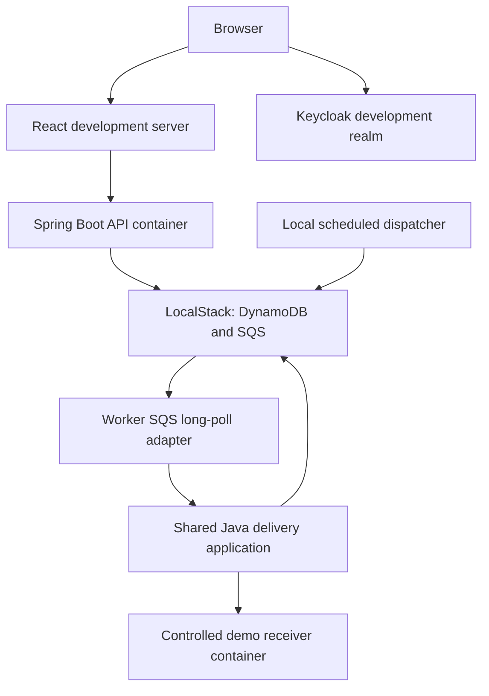
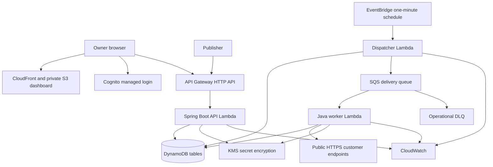

# High-level architecture

## At a glance

Read left to right across the top, then across the bottom. The event store represents the DynamoDB tables together. Dashboard management calls also pass through API Gateway; the dashboard connection is simplified here. The dispatcher reads durable pending deliveries, and the worker records results for later retries.

## Logical system

The delivery record doubles as a transactional outbox. DynamoDB is the source of truth; SQS carries wake-up notifications. A record remains discoverable until a worker claims it, so a lost notification or a publish crash can be recovered. Customer HTTP failures are stored as delivery state rather than repeatedly failing the SQS handler.

## Local deployment

Only a local development profile can permit the exact demo receiver host. Production rejects private destinations. Never allow arbitrary private URLs through a global development bypass.

## AWS deployment design

Use AWS Serverless Java Container for the Spring Boot API adapter; worker and dispatcher use thin Lambda handlers around shared Java services. Local adapters run the same services in ordinary processes. Verify compatibility and cold-start behavior before choosing final dependency versions.

Initial AWS Lambdas stay outside a VPC to avoid NAT gateway infrastructure and allow public delivery. Least-privilege IAM separates API, dispatcher, and worker capabilities. Cognito access-token verification occurs in Spring Security; publisher routes use application API keys, not API Gateway usage-plan keys.

## Reliability and cost tradeoffs

- One-minute dispatch polling means initial delivery can wait approximately a polling interval, plus queueing and startup. No subsecond latency promise. Add a best-effort immediate notification after commit later if measurements justify it.
- Durable due times support retries beyond SQS's 15-minute delay limit without holding workers asleep.
- Dispatcher polls a sharded due-work index, not a whole-table scan. Persistent due items handle eventual index visibility.
- DynamoDB on-demand capacity, bounded worker concurrency, short log retention, no provisioned concurrency, and no Kubernetes/Redis/RDS in the initial design.
- There is no fixed monthly price promise. Repeated dispatch, fan-out, traffic, logs, authentication, and scheduled polling incur usage. Enable budget alerts, which do not impose a hard spending cap, before deployment.
- Deploy only for smoke tests/demos at first. CDK teardown procedures must explicitly account for retained data and identity resources.
