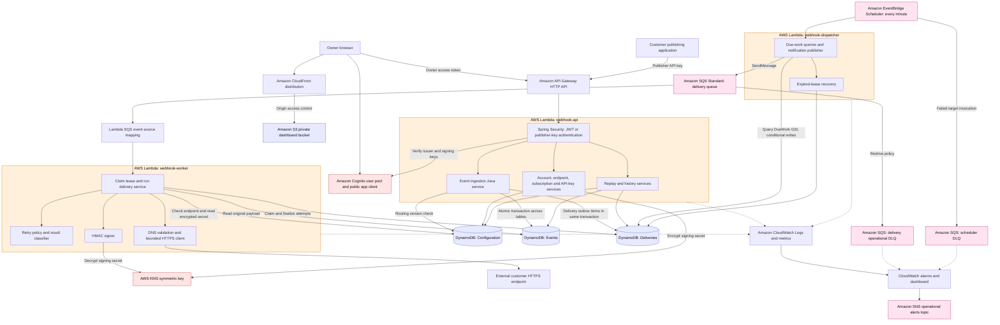
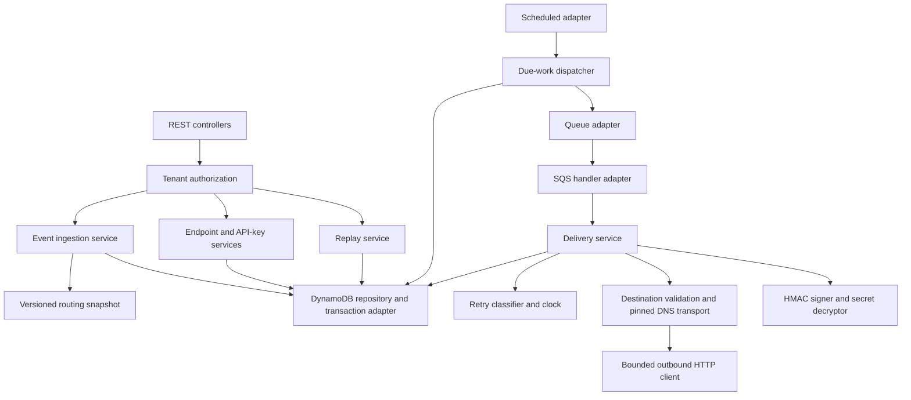
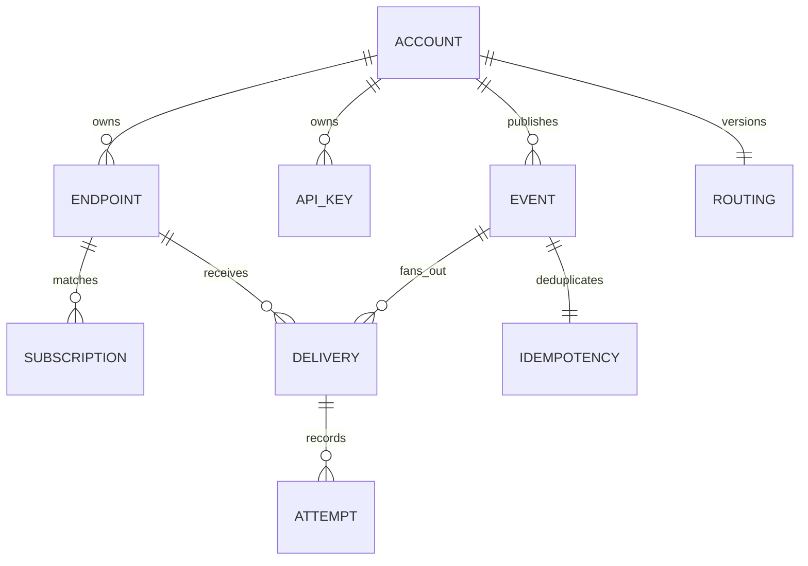
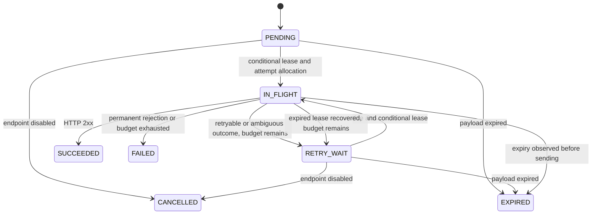

# Low-level design

## Concrete AWS resource map

This is the proposed deployment inventory, not a list of resources already deployed. Each orange boundary below is one Lambda function. Boxes inside it are Java classes/modules sharing that function, not separate AWS services. AWS service names and colors are used directly so the diagram remains portable in GitHub without external logo dependencies.

### Application component to AWS mapping

| Application component | Concrete AWS resource | Responsibility and boundary |
|---|---|---|
| REST controllers / ingestion | `webhook-api` Lambda behind one API Gateway HTTP API | Spring Boot routing, validation and atomic event acceptance |
| Tenant authorization | Java Spring Security inside API Lambda; Cognito user pool/app client | Cognito authenticates owners; application verifies JWT and tenant ownership. Publisher keys are checked in DynamoDB |
| Endpoint, subscription and key management | Same API Lambda | Configuration transactions; no separate management Lambda |
| Replay and delivery history | Same API Lambda | Reads tenant history and transactionally creates replay deliveries |
| Routing snapshot | Configuration table ROUTING item | Versioned routing data; routing selection executes inside API Lambda |
| Repository/transaction adapter | Java AWS SDK code in each Lambda | Not an independently deployed service; calls DynamoDB |
| Outbox | Delivery META items in Deliveries table | Durable pending work stored atomically with event acceptance |
| Scheduled adapter | One EventBridge Scheduler recurring schedule and invocation IAM role | Invokes dispatcher every minute; target retries and separate scheduler DLQ configured in CDK |
| Due-work dispatcher and recovery | `webhook-dispatcher` Lambda | Queries due index shards, publishes wake-ups, recovers expired leases |
| Queue adapter | AWS SDK in dispatcher; SQS Standard queue | Sends small tenant/delivery/generation messages |
| SQS handler adapter | Lambda event source mapping and worker handler | Polling/invocation, queue deletion on success and per-message failure reporting |
| Delivery service | `webhook-worker` Lambda | Conditional lease, attempt allocation, request execution and durable outcome |
| Retry classifier/clock | Java classes inside worker; recovery logic inside dispatcher | Computes next due time; DynamoDB persists it. No sleeping execution |
| Destination validation and HTTP client | Java code inside worker | DNS/IP restrictions, connection pinning, TLS and timeout enforcement; not API Gateway outbound delivery |
| Signature generation | Java HMAC implementation inside worker | KMS decrypts the stored secret; Java generates each request signature |
| Secret encryption | One customer-managed symmetric KMS key | API encrypts endpoint secrets; worker decrypts. API-key secrets are hashed, not encrypted for retrieval |
| Dashboard | Private S3 bucket and CloudFront distribution with origin access control | React static files; browser calls API and Cognito |
| Logs/metrics/alarms | Three CloudWatch log groups, application metrics, alarms and one dashboard | Short retention; no payloads/secrets; alarm dimensions avoid unbounded per-tenant cardinality |
| Alert delivery | One SNS topic | Alarm destination; human email subscription configured only when an address is selected |
| Infrastructure definition | TypeScript CDK synthesized to CloudFormation | Creates resources, policies, routes and outputs; not part of the request flow |

### Supporting resource inventory

The CDK implementation must account for these resources as well as the main services:

- **API Gateway:** one HTTP API, Lambda proxy integration, routes, stage, throttling and access-log group. Authentication is in Spring Security; do not accidentally treat publisher keys as Cognito tokens.
- **Identity:** one Cognito user pool, browser app client without a client secret, managed-login domain and explicit callback/logout URLs. Local development uses a separate OIDC provider.
- **Compute:** three Lambda functions, three dedicated execution roles, explicit log groups, gateway invocation permission, and one SQS event source mapping. Dispatcher runtime and scheduler invocation role are separate identities.
- **Data:** three DynamoDB tables; Deliveries has DueWork, ByTenant and ByEvent GSIs. TTL applies to expiring items. Database encryption at rest is separate from application-level signing-secret encryption. No DynamoDB Streams dependency in this design.
- **Messaging:** delivery queue, delivery operational DLQ, scheduler invocation DLQ, redrive policies, retention/visibility settings and queue policies. Scheduler DLQ covers failed invocation; dispatcher runtime failures remain visible through Lambda alarms and durable due-work recovery on the next tick.
- **Scheduling:** one EventBridge Scheduler schedule with flexible window disabled, bounded invocation retries, and its execution role. It is a recurring dispatcher trigger; there is no per-delivery schedule.
- **Encryption:** one KMS symmetric key, alias and key policy. Configuration stores encrypted signing secrets; Secrets Manager is not needed for that path.
- **Hosting:** one S3 dashboard bucket with public access blocked, bucket policy, CloudFront distribution and origin access control. Initially use service-provided HTTPS hostnames; Route 53 and ACM custom-domain resources are optional future additions.
- **Operations:** API access logs plus three Lambda log groups; queue-age, DLQ, Lambda-error/throttle and application-lag alarms; SNS topic and topic policy; budget alert configuration before deployment. Budgets alert rather than enforce a hard cap.
- **Deployment assets:** CDK bootstrap asset bucket/roles and any asset repository required by the chosen packaging. Initial plan uses ZIP Java artifacts and static assets; an ECR image repository is unnecessary unless packaging changes to containers.

### Permissions by execution role

| Role | Required access |
|---|---|
| API Lambda | Configuration, Events and Deliveries reads/writes/transactions and required history indexes; KMS Encrypt; logs/metrics |
| Dispatcher Lambda | Deliveries table and DueWork index reads, conditional updates and attempt recovery transactions; delivery queue SendMessage; logs/metrics |
| Worker Lambda | Delivery queue receive/delete/visibility and attributes; Configuration/Events reads; Deliveries transactional writes; KMS Decrypt; logs/metrics |
| Scheduler invocation | Invoke dispatcher Lambda; send failed invocations to scheduler DLQ |
| CloudFront origin access | Read dashboard objects through a distribution-restricted S3 policy |

Scope table, index, queue, function and key resources explicitly. Some CloudWatch metric permissions require wildcard resource scope; constrain their namespace where supported. CloudFormation deployment roles are separate from runtime roles.

**Step Functions is not part of this design.** The delivery state machine is Java logic plus durable DynamoDB state; EventBridge Scheduler and the dispatcher wake due work. Redis, SNS fan-out, EC2, ECS, Kubernetes, VPC/NAT gateways and an application load balancer are also unnecessary for this initial deployment. SNS is used only for operational alerts.

## Components and dependency boundaries

Use a modular monolith/shared application library with separate runtime entry points, rather than independent microservice repositories. Inject Clock, transport, repository, and queue interfaces for deterministic failure tests. Do not put business state transitions in controllers or Lambda handlers.

## Logical entities

These are logical relationships, not foreign-key constraints. Every access is scoped using tenant identity derived from credentials, never trusted from a request body.

## DynamoDB tables and access patterns

Use three tables initially for understandable boundaries. All tables have PK/SK string keys. Encrypt at rest and set TTL on expiring item types. Attributes below are abbreviated; timestamps use UTC, numeric due times use epoch milliseconds, TTL uses epoch seconds.

| Table / entity | PK | SK | Important attributes |
|---|---|---|---|
| Configuration / account | TENANT#t | META | ownerSub, createdAt |
| Configuration / owner lookup | OWNER#sub | ACCOUNT | tenantId; transactional uniqueness on account creation |
| Configuration / endpoint | TENANT#t | ENDPOINT#e | URL, enabled, secretCiphertext, keyVersion |
| Configuration / routing | TENANT#t | ROUTING | version, bounded endpoint/type snapshots |
| Configuration / API key | KEY#publicId | META | tenantId, secretDigest, revokedAt, scope |
| Configuration / key listing | TENANT#t | KEY#publicId | display prefix, createdAt, revokedAt |
| Events / event | TENANT#t | EVENT#time#eventId | type, exact payload bytes, payloadHash, expiresAt |
| Events / idempotency | TENANT#t | IDEM#hash | requestHash, event pointer, acceptance result, expiresAt |
| Deliveries / delivery | TENANT#t#DELIVERY#d | META | event pointer, endpoint snapshot, state, generation, lease, attemptCount, dueAt |
| Deliveries / attempt | TENANT#t#DELIVERY#d | ATTEMPT#zeroPaddedNumber | start/end, outcome, HTTP status, duration |

Payload exists only on the event item, not in queue messages, logs, indexes, delivery snapshots, or attempts. Index projections include identifiers/state only. Delivery and attempt metadata expire after 30 days; event/idempotency after seven days. A delivery stores original event expiry and may not extend it on replay.

Indexes on Deliveries:

| Index | Partition key | Sort key | Query |
|---|---|---|---|
| DueWork | WORK#shard | zeroPaddedDueEpoch#deliveryId | Query each of four fixed shards through now; paginate all results |
| ByTenant | TENANT#t | createdAt#deliveryId | Tenant history, newest first |
| ByEvent | TENANT#t#EVENT#eventId | createdAt#deliveryId | Event fan-out and replay history |

Only META records carry index attributes. PENDING/RETRY_WAIT records use dueAt; IN_FLIGHT records use leaseUntil so crashed attempts are recoverable. Terminal records remove DueWork attributes. Index reads are eventually consistent; conditional base-table writes establish correctness. Tenant endpoints and events use PK queries with SK prefixes and opaque pagination cursors. Key authentication uses a direct key-ID read plus constant-time secret verification. Never expose key-ID lookup records through tenant list APIs.

## Atomic acceptance and endpoint snapshot

Strongly read the bounded ROUTING item, select matching enabled endpoints, and validate its version in TransactWriteItems. Write one event, one idempotency item and up to ten delivery META records in that transaction. This is at most 13 transaction actions with one 64 KB payload copy. Configuration updates transactionally change endpoint metadata and the routing version. A racing configuration edit forces ingestion to reread and retry, giving a defined acceptance snapshot. Bound routing document size and reject oversized configuration; the 400 KB DynamoDB item limit still applies.

The idempotency condition allows replacement of an expired record before TTL deletion. Hash event type plus exact body bytes with an unambiguous length-prefixed encoding. An existing live matching record returns its original 202 result; a different hash returns 409. A timeout with an uncertain transaction outcome is resolved by a strongly consistent idempotency lookup. Revalidate revoked API keys on acceptance retries. Revocation stops new authenticated operations; already authorized in-flight requests can finish.

## Delivery state machine

For a recovered lease with attemptCount=8, transition to FAILED rather than retry. An in-flight send begun before expiry may finish after expiry. Replay creates another PENDING delivery, never rewinds a terminal record.

## Outbox, leases, and retry recovery

1. Dispatcher queries all DueWork shards with due time <= now. Strongly read current record and verify state/generation before acting.
2. For due PENDING/RETRY_WAIT work, send deliveryId, tenantId, generation to SQS. Do not delete the durable work record or mark it delivered. Conditional rescheduling of its next dispatch check to now+60s limits duplicate notifications. If send or update fails, the record stays discoverable; duplicates are safe wake-ups.
3. Worker claims only a due, eligible generation with a conditional transaction: increment attemptCount, assign a random leaseToken, set IN_FLIGHT, set a 90-second lease, and insert a STARTED attempt. Initial AWS worker timeout: 30 seconds, batch size 1, SQS visibility timeout at least 180 seconds. Validate those settings during implementation.
4. Worker rereads current endpoint enabled state, checks event expiry, validates destination, signs exact event bytes, and sends within a ten-second total deadline.
5. Finalization transaction requires matching leaseToken and generation, finishes the attempt, and records terminal state or RETRY_WAIT with generation+1 and its next due time.
6. Queue message is acknowledged after durable finalization. Unexpected storage/processing failures fail that message; configure partial batch responses if batches are increased.
7. Expired IN_FLIGHT leases are recovered transactionally: mark old attempt UNKNOWN, invalidate the lease, then retry or fail based on consumed budget. Stale workers cannot overwrite state. They may already have sent HTTP; exactly-once delivery is impossible at that boundary.
8. Operational DLQ messages raise an alarm and are inspected/redriven after repair. They are distinct from customer deliveries in FAILED state. Durable work may still recover independently; repeated errors require disabling dispatch for affected work while investigating.

The attempt budget counts allocated outbound attempts, including crash-ambiguous ones. Receiver idempotency should use event ID for business processing; delivery ID identifies a particular fan-out/replay operation.

## Retry policy

Eight total attempts: initial attempt and seven retry delays of 1m, 5m, 15m, 1h, 3h, 6h, and 13h45m. Delays are measured from prior completion; apply 0.9-1.1 bounded jitter. This is roughly 24 hours, not an exact deadline. Polling, outages, and Retry-After can extend it.

- Retry network failures, DNS/transient transport errors, timeout, HTTP 408, 429, and 5xx.
- 2xx succeeds; other 4xx and all 3xx are permanent failures. Never follow redirects.
- Parse Retry-After on 429/503 as seconds or HTTP date; schedule no earlier than that value, capped at 24 hours from now and original payload expiry. Malformed values fall back to policy.
- Reject invalid/private destination configuration as permanent security failure; do not spend eight attempts calling it.
- Retries preserve event ID and delivery ID; attempt number and signature timestamp change.

## Signing, identity, and outbound security

Headers: Webhook-Event-Id, Webhook-Delivery-Id, Webhook-Attempt, Webhook-Timestamp, Webhook-Key-Version, Webhook-Signature. Sign an unambiguous versioned string containing timestamp, event ID, delivery ID, attempt number, and exact raw UTF-8 body with HMAC-SHA256. Publish that byte-level format and a receiver test vector before implementation. Receivers verify signature in constant time, enforce a suggested five-minute clock tolerance, and deduplicate event IDs.

Generate random API-key secrets, return once, persist only a cryptographic digest and public lookup ID. Encrypt retrievable endpoint signing secrets with KMS in AWS; use a local-only development key outside Git. Signing-key rotation keeps a bounded overlap of versions at receivers; queued deliveries use the current signing key/version at dispatch. API key rotation creates a new key before revoking the old one.

JWT validation checks signature/JWKS, issuer, expiry, token_use=access and allowed client_id; resolve the owner sub to a tenant. Local provider has its own issuer/audience validation; never accept local tokens in AWS. Use managed login/authorization code with PKCE and avoid persisted browser tokens where possible.

URL validation must reject loopback, link-local, RFC1918, IPv6 private/reserved ranges, metadata addresses, URL credentials, and unsupported ports/schemes. Resolve at send time, validate every resolved address, pin the connection to a validated address while retaining the original TLS hostname/SNI, and revalidate on every reconnect. Disable redirects and environment proxies. A validation lookup followed by ordinary client DNS resolution is insufficient. Bound headers and response reads; store status/error category only, never arbitrary receiver response bodies. This transport is a release gate requiring adversarial tests.
